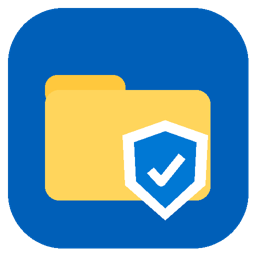

# NAS-Zentrale

Ein Windows-Programm, das die Verwaltung einer **TrueNAS-SCALE-Dateifreigabe** an einem Ort bündelt:
Ordner, Dateien, Windows-Freigaben und **alle Rechte** – ohne Wechsel zwischen Windows-Explorer,
TrueNAS-Weboberfläche und AD-Werkzeugen.



## Was das Programm löst

* **AD-Benutzer und -Gruppen überall verwenden** – auch in Unterordnern. Die PCs müssen dafür *nicht*
  in der Domäne sein: Rechte werden direkt über TrueNAS gesetzt, und TrueNAS kennt alle AD-Konten.
  (Der Windows-Explorer kann das auf PCs außerhalb der Domäne nicht.)
* **Windows-Rechte = TrueNAS-Rechte.** Die Datasets nutzen NFSv4-ACLs – genau das, was Windows anzeigt.
  NAS-Zentrale zeigt und bearbeitet beides in *einer* Ansicht, mit allen 14 Einzelrechten.
* **Überblick:** „Wer darf wo?“ zeigt für jeden Benutzer und jede Gruppe alle Ordner mit dem tatsächlichen
  Zugriff (inklusive Gruppenmitgliedschaften). Ordner mit eigenen Rechten sind überall mit einem Schild markiert.
* **Sicher ändern:** Vor jedem Speichern zeigt eine Vorschau genau, was sich ändert und wie viele Ordner und Dateien
  betroffen sind. Jede Änderung landet im gemeinsamen Protokoll und kann rückgängig gemacht werden.

## Funktionen

| Bereich | Was geht |
|---|---|
| **Dateien & Rechte** | Ordnerbaum und Dateiliste; Öffnen, Neuer Ordner, Umbenennen, Kopieren, Ausschneiden, Einfügen, Löschen, Hochladen (auch per Drag & Drop aus dem Explorer). Rechts daneben die Rechte des gewählten Ordners bzw. der gewählten Datei: Einträge hinzufügen und entfernen, Vorlagen (Vollzugriff / Ändern / Lesen / Nur durchgehen) oder einzelne Rechte, „Gilt für“ wie in Windows, Verweigern, Vererbung an/aus, Besitzer ändern, „Zugriff prüfen“ für einen bestimmten Benutzer. |
| **Wer darf wo?** | Alle Ordner mit eigenen Rechten auf einen Blick; pro Benutzer/Gruppe der effektive Zugriff an jeder Stelle und über welche Gruppe er entsteht. Doppelklick öffnet den Ordner. |
| **Freigaben** | SMB-Freigaben anlegen, bearbeiten, (de)aktivieren und entfernen; Freigabeberechtigungen; „Nur sichtbare Ordner zeigen“ (ABE). Datasets mit Speicherbelegung; neue Datasets direkt für Windows-Freigaben angelegt. |
| **Protokoll** | Wer hat wann was geändert – gemeinsam für alle Admins, gespeichert auf dem NAS. Suchen, filtern, **Rückgängig** für Rechte- und Freigabeberechtigungs-Änderungen. |

### So funktioniert die Weitergabe von Rechten

Wird ein Recht an einem Ordner geändert, das an Unterordner vererbt wird, gibt NAS-Zentrale die Änderung wie der
Windows-Explorer an alle Unterordner und Dateien weiter. **Unterordner mit eigenen Rechten behalten diese**:
Die neue Vererbung von oben wird mit ihren eigenen Einträgen kombiniert. Ordner mit deaktivierter Vererbung bleiben
unverändert. TrueNAS selbst würde beim rekursiven Setzen alle Sonderrechte überschreiben, deshalb prüft das
Programm vorher alle Unterordner und stellt ihre eigenen Rechte danach gezielt wieder her.
Ändert sich an der Vererbung nichts (z. B. „Nur dieser Ordner“), wird nur der eine Ordner angefasst.

## Einrichtung (einmalig, ca. 10 Minuten)

### 1. TrueNAS: AD-Gruppe als Admin zulassen

Die Anmeldung im Programm erfolgt mit dem AD-Konto. TrueNAS lässt nur Konten zu, denen Admin-Rechte gegeben wurden:

1. Im AD eine Gruppe anlegen, z. B. `NAS-Admins`, und die Admins dort aufnehmen.
2. In TrueNAS: **Credentials → Groups** → oben rechts **Privileges** → **Full Admin** bearbeiten →
   bei **Directory Services Groups** die Gruppe `FIRMA\NAS-Admins` hinzufügen → Speichern.

### 2. TrueNAS: Datasets für Windows

Datasets für Windows-Freigaben müssen NFSv4-Rechte verwenden. Das ist der Fall, wenn sie mit dem Freigabetyp **SMB**
angelegt wurden. NAS-Zentrale legt neue Datasets automatisch so an. Datasets ohne NFSv4 werden in der App markiert
(„Keine Windows-Rechte“).

### 3. Netzwerk

Die Admin-PCs müssen das NAS über **HTTPS (Port 443)** für die Verwaltung und **SMB (Port 445)** für Dateiaktionen erreichen.

### 4. Programm starten

1. `NAS-Zentrale.exe` herunterladen (siehe unten) und starten. Eine Installation ist nicht nötig.
2. NAS-Adresse eingeben (z. B. `nas.firma.local` oder die IP), Benutzer als `FIRMA\vorname.nachname`, AD-Passwort.
3. Beim ersten Mal das NAS-Zertifikat bestätigen. TrueNAS nutzt meist ein eigenes Zertifikat; der Fingerabdruck wird gemerkt.
4. Danach fragt das Programm einmalig nach einem Ordner für das **gemeinsame Protokoll** und nach der Admin-Gruppe.
   Darin entsteht ein versteckter Ordner `.nas-zentrale`, auf den nur die Admin-Gruppe Zugriff hat.
   Weitere Admins wählen denselben Ordner.

> Für Dateiaktionen (Kopieren, Löschen …) arbeitet das Programm über die SMB-Freigabe mit den Rechten des
> angemeldeten AD-Kontos. Die Admin-Gruppe sollte deshalb in den Ordnern, die sie verwaltet, Vollzugriff haben.

## Download

* **Fertige .exe:** Unter *Actions → Build* im letzten Lauf das Artefakt **NAS-Zentrale** herunterladen
  oder – nach dem Setzen eines Versions-Tags `v1.0.0` – unter *Releases*.
* Voraussetzung: Windows 10/11, 64 Bit. .NET muss nicht installiert sein (ist in der .exe enthalten).

## Ausprobieren ohne echtes NAS (Demo)

`tools/demo-truenas/demo_truenas.py` simuliert ein TrueNAS mit AD-Benutzern, Ordnern und Rechten:

```bash
pip install websockets
```

```bash
python tools/demo-truenas/demo_truenas.py
```

Dann in NAS-Zentrale anmelden mit Adresse `http://127.0.0.1:8765`, Benutzer `FIRMA\admin`, Passwort `geheim`.
(Dateiaktionen sind in der Demo nicht möglich, da kein SMB vorhanden ist.)

## Sicherheit

* Passwörter werden **nie gespeichert**; nur Adresse, Benutzername (optional) und der bestätigte Zertifikats-Fingerabdruck
  liegen unter `%APPDATA%\NAS-Zentrale`.
* Die Verbindung zum NAS ist verschlüsselt (WSS/HTTPS). Ändert sich das Zertifikat, warnt das Programm deutlich.
* Alle Änderungen laufen über die offizielle TrueNAS-API bzw. SMB mit den Rechten des angemeldeten Kontos und werden protokolliert.

## Gut zu wissen / Grenzen

* Beim Weitergeben von Rechten erhalten **einzelne Dateien** mit individuell gesetzten Rechten wieder die vererbten Rechte
  (Ordner mit eigenen Rechten bleiben erhalten). Die Vorschau weist darauf hin.
* **Untergeordnete Datasets** werden beim Weitergeben nicht verändert, ihre Rechte werden separat gepflegt.
* AD-Benutzer und -Gruppen werden nur ausgewählt, nicht im AD angelegt. Neue AD-Konten erscheinen, sobald TrueNAS seinen
  Verzeichnis-Cache aktualisiert hat. Über „direkt im AD suchen“ lassen sie sich sofort finden.
* „Wer darf wo?“ berücksichtigt Ordnerrechte inklusive Gruppen. Freigabeberechtigungen können den Netzwerkzugriff zusätzlich einschränken.

## Entwicklung

* `src/NasZentrale.Core` – TrueNAS-API-Client, Rechte-Modell, Vererbungslogik, Protokoll (plattformunabhängig, getestet)
* `src/NasZentrale` – WPF-Oberfläche im Windows-11-Stil ([WPF-UI](https://github.com/lepoco/wpfui))
* `tests/NasZentrale.Core.Tests` – Tests u. a. für Weitergabe mit Erhalt eigener Unterordner-Rechte und exaktes Rückgängigmachen

```bash
dotnet test tests/NasZentrale.Core.Tests
```

```bash
dotnet publish src/NasZentrale -c Release -r win-x64 -p:DebugType=none -o publish
```
